  
  
  

 

  

<b>About me / background &amp; availability</b>

I'm an **Information Systems student at Universitas Klabat (2023–2027)**, based in **Manado, Indonesia**.

- **Now:** system development intern at LLDIKTI Wilayah XVI.
- **Recently:** Best Technical Excellence Award, Proxo Coris 2026, mobile apps.
- **Open to:** internships and collaborations on web, mobile or AI projects.
- I care about **clean architecture and testing** as much as how things look.

[View my resume](https://adrielwalintukan.my.id/Resume_Adriel_Walintukan.pdf) · [Let's talk](mailto:adrielwalintukan27@gmail.com)

  

<b>Selected work / project links &amp; descriptions</b>

- [**DailyBoost AI**](https://github.com/adrielwalintukan/DailyBoostAI_MAD): productivity app with goals, budgeting and an AI chat assistant.
- [**AI Interview Simulator**](https://github.com/adrielwalintukan/interviewAI): practice interviews with an AI interviewer.
- [**KostFinder UNKLAB**](https://adrielwalintukan.my.id/#projects): boarding house search and booking for students, with a price calculator.

  

<b>Tech stack / explore the tools I use</b>

| Area | Technologies |
| --- | --- |
| Backend &amp; AI | Python, FastAPI, Google Gemini, REST API, Node.js, PostgreSQL, Laravel, Supabase, Convex, SQL |
| Frontend &amp; mobile | React Native, Expo, Next.js, TypeScript, JavaScript, Vite, Blade |
| Tools &amp; design | Git, GitHub, Figma, Software Testing |

  

