<a href="https://adrielwalintukan.my.id">
  
</a>

  


  

<a href="https://github.com/adrielwalintukan/DailyBoostAI_MAD"></a>
<a href="https://github.com/adrielwalintukan/interviewAI"></a>
<a href="https://adrielwalintukan.my.id/#projects"></a>

  


  


  

  <a href="https://adrielwalintukan.my.id"></a>
  <a href="https://www.linkedin.com/in/adriel-walintukan-383032332/"></a>
  <a href="mailto:adrielwalintukan27@gmail.com"></a>

