 

  
  
  

 

<b>About me / background &amp; availability</b>

I'm an **Information Systems student at Universitas Klabat (2023–2027)**, based in **Manado, Indonesia**.

- **Now:** system development intern at LLDIKTI Wilayah XVI.
- **Recently:** Best Technical Excellence Award, Proxo Coris 2026, mobile apps.
- **Open to:** internships and collaborations on web, mobile or AI projects.
- I care about **clean architecture and testing** as much as how things look.

[View my resume](https://adrielwalintukan.my.id/Resume_Adriel_Walintukan.pdf) · [Let's talk](mailto:adrielwalintukan27@gmail.com)

 

 

